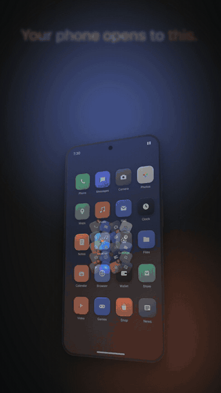
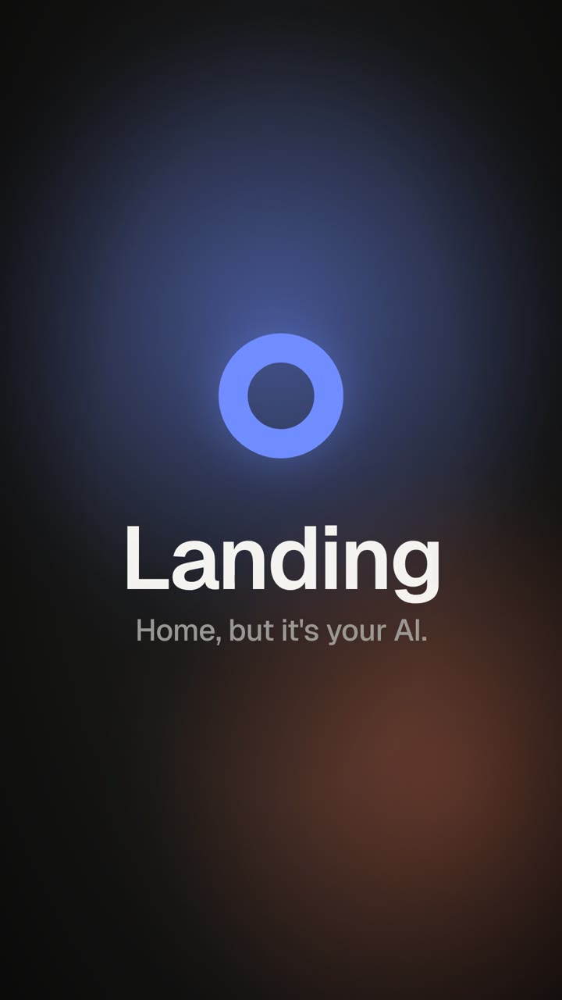

# Landing

**Make any AI your home screen.**

Landing is a tiny Android Home app that disappears. Press Home and you're in ChatGPT, Claude, Gemini, Perplexity, or whatever app you pick, with no grid of icons in between. Your other apps are one double-press away.

<p align="center">
  
  &nbsp;&nbsp;
  
</p>

## Features
- **Any app as Home.** AI assistants are listed first in setup, but anything works.
- **Invisible hand-off.** Landing draws nothing on a Home press. It brings your app forward with zero animation, so there's no flash and no launcher in between.
- **Double-press drawer.** Press Home twice quickly for all your apps, with search. Swipe it down or press Home again to go back. Long-press any app to make it your Home.
- **Open on unlock (optional).** Unlock the phone and land in your AI instead of whatever was open last.
- **Pick the exact screen.** Open the app where you left off, fresh every time, on an app shortcut (like "New chat" or "Voice"), on a specific screen, or on a deep link.
- **No internet permission, no accounts, no tracking.** Landing can't send anything anywhere.

## Install
1. Download [`Landing-1.0.1.apk`](https://github.com/CharlesBuildsAI/Landing/raw/main/release/Landing-1.0.1.apk) on your phone (also in [`release/`](release/)).
2. Open it. If Android asks, allow your browser or file app to "install unknown apps".
3. Open **Landing** and follow the five-step setup:
   1. Pick your app, then tap **Set as Home app** and choose Landing. If no prompt appears, go to Settings → Apps → Default apps → Home app → Landing.
   2. (Optional) Turn on **Open on unlock**.
   3. Learn the double press.
4. Press Home. That's it.

**To undo:** Settings → Apps → Default apps → Home app → pick your old launcher. Then uninstall Landing like any app.

> Upgrading from 1.0.0? Install 1.0.1 over it; it's signed with the same key and keeps your settings.
> Upgrading from 0.9.0-beta1? 1.0.x is signed with a new release key, so uninstall the beta first.

## How it works
- Landing registers as a Home activity (`CATEGORY_HOME`) with a fully transparent theme and no starting window. On a Home press it starts your chosen app's launch intent with a zero-duration transition, the same intent your old launcher would send, so a running app resumes where you left it.
- Two Home presses within 900 ms show the drawer instead: a bottom sheet over the blurred wallpaper with a velocity-aware spring.
- **Open on unlock:** a minimal foreground service listens for the screen turning off and brings your app to the front then, so it's already there when you unlock. It skips this during calls. Android only lets a background app start an activity if it holds "display over other apps". Landing uses that permission only to open your app and never draws an overlay.
- Settings live in a private `SharedPreferences` file on your phone. Nothing leaves the device.

## Permissions
| Permission | Why |
|---|---|
| `SYSTEM_ALERT_WINDOW` (display over other apps) | Only for **Open on unlock**: Android blocks background activity starts without it. Never used to draw anything. Optional. |
| `FOREGROUND_SERVICE`, `FOREGROUND_SERVICE_SPECIAL_USE` | Keeps the tiny unlock watcher alive while other apps are open. It runs only when Open on unlock is on, with a silent, minimal notification. |
| `RECEIVE_BOOT_COMPLETED` | Restarts the unlock watcher after a reboot or an update, if you turned it on. |
| Package visibility (`<queries>` for launcher apps) | Lists your installed apps in setup and the drawer. |

No internet, contacts, location, microphone, storage, or notification-reading permissions.

## Build from source
Requirements: JDK 17+, plus the Android SDK with **platform 35** and **build-tools 35** (from Android Studio's SDK Manager or `sdkmanager "platforms;android-35" "build-tools;35.0.0"`). Gradle isn't needed.

```bash
git clone https://github.com/<you>/landing.git
cd landing
export ANDROID_HOME=~/Android/Sdk      # wherever your SDK lives
./build.sh                              # → dist/Landing-1.0.1-debug.apk
```

Release build with your own key (keep it outside the repo):
```bash
keytool -genkeypair -keystore ~/keys/landing-release.jks -alias landing \
  -keyalg RSA -keysize 4096 -validity 10000 -dname "CN=Landing"
KEYSTORE=~/keys/landing-release.jks KEY_ALIAS=landing KS_PASS='…' ./build.sh
```
Individual tools can be overridden with `AAPT2`, `D8`, `ZIPALIGN`, `APKSIGNER`, and `ANDROID_JAR`.

Layout:
```
app/AndroidManifest.xml
app/res/                         icon, transparent theme, Geist font
app/src/com/crit/landing/
  HomeActivity.java              hand-off, double-press drawer, settings
  OnboardingActivity.java        five-step setup
  UnlockService.java             optional open-on-unlock watcher
  BootReceiver.java              restarts the watcher after reboot/update
  AiApps.java                    which apps are listed under "Featured"
  Ui.java                        palette, font, and small vector glyphs
release/                         signed release APKs
third_party/geist/OFL.txt        font license
build.sh                         Gradle-free build
```

## Limits
- **Sideload only for now.** It isn't on Google Play or another store yet.
- **Restricted settings (Android 13+).** For sideloaded apps, the "display over other apps" toggle may be greyed out. Open App info → ⋮ → **Allow restricted settings**, then turn it on. Setup walks you through it.
- **Aggressive battery savers** (some Xiaomi, Oppo, Vivo, and OnePlus skins) can kill the unlock watcher. Set Landing's battery to **Unrestricted**.
- **Gesture navigation:** a Home swipe works like a Home press. "Swipe up and hold" for recents still shows the system recents.
- **No widgets, wallpaper picker, icon packs, or home-screen folders.** That's on purpose.
- Some AI apps ignore a "fresh start" or expose no shortcuts. Then Landing simply opens the app normally.
- Landing doesn't replace the assistant gesture (long-press power or corner swipe). Set that under Settings → Apps → Default apps → Digital assistant, if your AI app supports it.
- Not affiliated with OpenAI, Anthropic, Google, Perplexity, or any AI company. App names are used only to recognise installed apps.

## License
[MIT](LICENSE) © 2026 Charles Connelly

The bundled [Geist](https://github.com/vercel/geist-font) font is © 2024 The Geist Project Authors, under the [SIL Open Font License 1.1](third_party/geist/OFL.txt).
